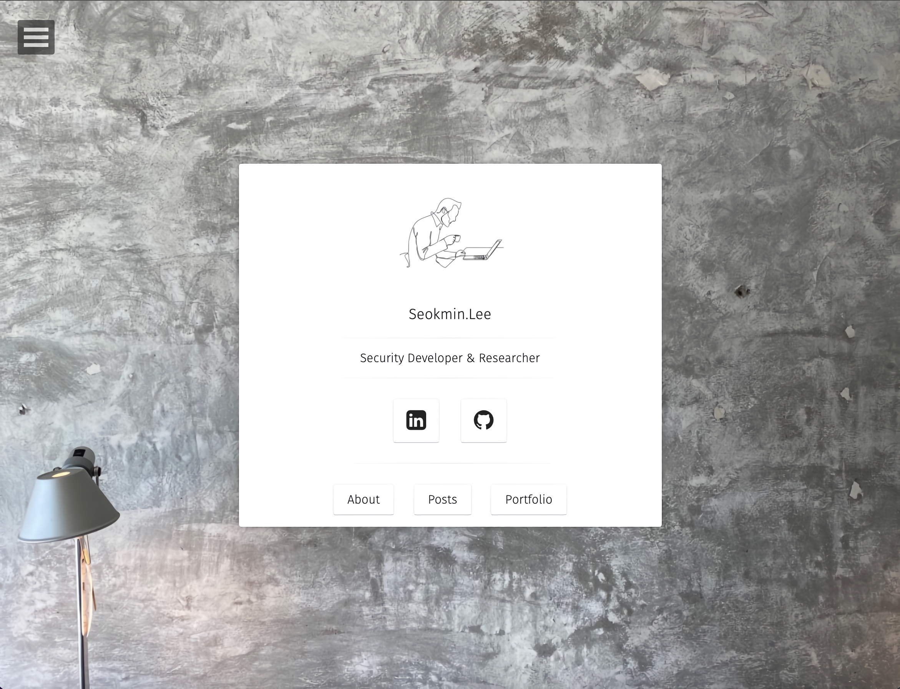

  

  
   

##

 📑 Bookmark

  

 📰 News Scrap

## 

* 보안 자격증 관련 생각: <https://www.boannews.com/media/view.asp?idx=101572>
* 삼성SDS 기업보고서, 어떤 사람을 뽑을 것인가? <https://post.naver.com/viewer/postView.naver?volumeNo=32605627&memberNo=9028903&vType=VERTICAL> 
* 파이썬으로 진행하는 기업 보안: <https://www.samsungsds.com/kr/story/wch_cloud210924.html?moreCnt=0&backTypeId=story&category=all>

  
  
# ETC
* 온라인책 무료: <https://wikidocs.net/>
* Google Developer Korea:(6~8월) <https://developers-kr.googleblog.com/>
* 길벗: <http://book.interpark.com/book/genbookeventaction.do?_method=EventPlan&sc.evtNo=238595>
* 이미지 로고: <https://icons8.com/icons/set/bash>
* 면접: <https://gyoogle.dev/blog/>
* Github Campus Experts:(2월,8월) <https://github.com/gce-korea> 
* GCE Q & A: <https://www.youtube.com/watch?v=k3g7Ev43uJg>
* Google Trend: <https://trends.google.com/trends/trendingsearches/daily?geo=KR>
* 영문법검사: <https://app.grammarly.com/>
* 윈도우key 학교계정 발급: <https://cjekjy.tistory.com/17>
* 개발 자소서 잘 쓰는법: <https://sohyunwriter.tistory.com/123?fbclid=IwAR05B9f9BlGW4pYevj_o08NfSr-PpJpLd0k1itrVK5q8z-qCeLYmD1DwFRQ>
* 인프런 정보보안 입문 무료강의: <https://www.inflearn.com/course/%EC%A0%95%EB%B3%B4%EB%B3%B4%EC%95%88-%EC%BB%A4%EB%A6%AC%EC%96%B4-%EC%9E%85%EB%AC%B8>
* Ubuntu vmdk or vdi: <https://www.linuxvmimages.com/images/ubuntu-1604>
* Github Toc Generator: <https://ecotrust-canada.github.io/markdown-toc/>
* 소켓통신 윤성우 코드 자료: <https://www.orentec.co.kr/jaryosil/TCP_IP_1/add_form.php>
* 좋은 코딩 방법이란? : <https://brunch.co.kr/@neverlish/21>

# Security

## CVE
* NVIDIA_CVE: <https://www.nvidia.com/en-us/security/>
  
  
## Blockchain
* 김승주 교수님 블록체인과 암호화폐 교육자료: <https://blog.naver.com/amhoin/222593482310>
  
  
## Education
* KISEC: <https://www.kisec.com/home>
  
## OSCP (Offensive Security Certified Professional자격증 준비 
* 실무위주의 자격증(기본적인 모의 침투 테스트의 방법)
* Big Overview : <https://blog.sunggwanchoi.com/kor-oscp-review/>
* 생각보다 준비하는 사람들이 많은 것 같다.: <https://takudaddy.tistory.com/category/OSCP%20%EC%A4%80%EB%B9%84/OSCP%20%EA%B3%B5%EB%B6%80%EC%9D%BC%EC%A7%80?page=1>  
* OSCP 시험 준비: <https://myreversing.tistory.com/201>  

## Microarchitectural elements
* agner fog's blog: <https://www.agner.org/forum/viewforum.php?f=1>
  * agner fog's software development: <https://www.agner.org/optimize/#testp>
* <https://www.lazenca.net/pages/viewpage.action?pageId=25624857>
* <https://linux-kernel-labs.github.io/refs/heads/master/labs/memory_mapping.html>
* <https://uops.info/table_overview.html>
* <https://www.cs.swarthmore.edu/~kwebb/cs31/s15/bucs/virtual_memory_is.html>
* <https://www.kernel.org/doc/Documentation/x86/x86_64/mm.txt>
* <https://stackoverflow.com/questions/25852367/x86-64-canonical-address>
* Mastik: <https://cs.adelaide.edu.au/~yval/Mastik/>
* Intel CPU Listing: <https://en.wikipedia.org/wiki/List_of_Intel_CPU_microarchitectures#cite_note-17>    
    
# GPU Setting
* <https://m.blog.naver.com/tyami/221801088922>
* <https://m.blog.naver.com/ara96q/221829757416>
* <https://chancoding.tistory.com/89>
  
# GPU Computing (CUDA)
* 개념잡기: https://karl6885.github.io/cuda/2018/11/08/NVIDIA-CUDA-tutorial-1/
* <https://www.slideshare.net/EdisonLee1/cuda-moducon2018>
* <https://www.uio.no/studier/emner/matnat/ifi/IN5050/h18/undervisningsmaterialet/in5050-simd.pdf>  
* GPU의 역사: <https://89douner.tistory.com/159>

## GPUDirect 
* Case Implementation : <https://hpcadvisorycouncil.atlassian.net/wiki/spaces/HPCWORKS/pages/2791440385/GPUDirect+Benchmarking>
* GPU/GPGPU: <https://mkblog.co.kr/category/research_study/gpusresearch/>
* GPU: <http://mug.mvapich.cse.ohio-state.edu/static/media/mug/presentations/17/nvidia-mug-17.pdf>    

# Cloud Engineering
* [GCP](https://lifeoncloud.kr/featured/)
* 클라우드 (보안) (엔지니어릴) 입문 시작하기 : <https://brunch.co.kr/@topasvga/634>
  
# Coding-Test
* [sw expert academic (삼성)](https://swexpertacademy.com/main/capacityTest/main.do)
* <https://rebas.kr/789>
* https://code.plus/bundle/6
* https://www.acmicpc.net/workbook/top
* https://programmers.co.kr/learn/challenges?tab=algorithm_practice_kit
  
# DeepLearning
* Batchsize vs Epoch in model fit <https://snowdeer.github.io/machine-learning/2018/01/11/keras-model-fit-options/>
* <https://dacon.io/competitions/open/235698/overview/description>
* <https://library.etri.re.kr/service/data/etri-insight/down.htm;jsessionid=AE9EF6025C1F7A3679BA5FC5C213C9A9?id=652>
* <https://dacon.io/competitions/official/235815/data>  
* pytorch: <https://tutorials.pytorch.kr/>
* elice nipa 자격증 교육: <https://2021nipa.elice.io/explore>\
* Auto ML이란?: <https://medium.com/daria-blog/automl-%EC%9D%B4%EB%9E%80-%EB%AC%B4%EC%97%87%EC%9D%BC%EA%B9%8C-1af227af2075>
* <https://paperswithcode.com/>
  
## GAN
* <https://m.blog.naver.com/PostView.naver?blogId=euleekwon&logNo=221559102854&targetKeyword=&targetRecommendationCode=1>
* <https://comlini8-8.tistory.com/9>
  

## Target Site
* <https://ko.wikihow.com/HTML-%EC%BD%94%EB%93%9C%EB%A1%9C-%EC%9B%B9%EC%82%AC%EC%9D%B4%ED%8A%B8-%ED%95%B4%ED%82%B9%ED%95%98%EB%8A%94-%EB%B2%95>
* How to make? <http://yummyhit.kr/>
### JeKyll
  * <https://hmfaysal.github.io/Notepad/>
  * <http://the-development.github.io/flex/>
  * <https://devlopr.netlify.app/#/>
  * <https://luxedo.github.io/jekyll-theme-potato-hacker/>
  * <https://janczizikow.github.io/sleek/>
  * <https://taylantatli.github.io/Moon/> now
  
  
  
  
  

  
  

